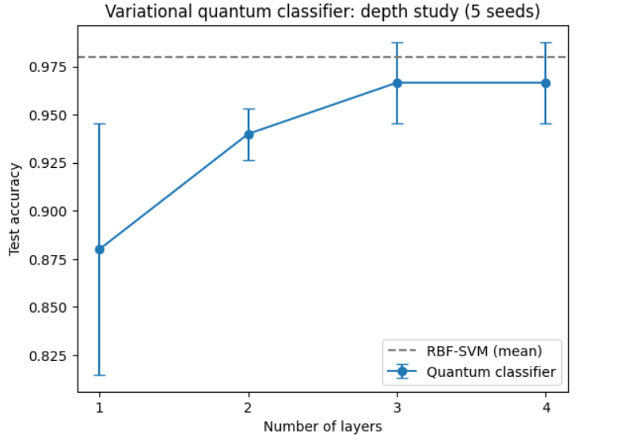

# Variational Quantum Classifier vs. Classical SVM: A Depth Study on Binary Iris Classification

A hybrid quantum-classical classifier built in [PennyLane](https://pennylane.ai/) and benchmarked against a classical RBF-SVM. The project studies how circuit depth (1 to 4 layers) affects classification accuracy on a small binary task, evaluated over 5 random train/test splits.



## Summary

| Model | Test accuracy (mean ± std, 5 splits) |
|---|---|
| Quantum classifier, 1 layer | 88.0% ± 6.5 |
| Quantum classifier, 2 layers | 94.0% ± 1.3 |
| Quantum classifier, 3 layers | 96.7% ± 2.1 |
| Quantum classifier, 4 layers | 96.7% ± 2.1 |
| Classical RBF-SVM | 98.0% ± 1.6 |

**Key findings**

- Accuracy rises from 88.0% to 96.7% as depth goes from 1 to 3 layers, then plateaus. The fourth layer adds no measurable benefit on this task.
- The 1-layer circuit has by far the highest variance across runs (±6.5 points), meaning it is very sensitive to initialization.
- At 3-4 layers the quantum model comes within about 1.3 points of the SVM but does not beat it. The honest summary is *comparable, with the classical baseline slightly ahead*. No quantum advantage is expected or claimed at this scale.

## Method

**Task.** Binary classification of *Iris versicolor* vs. *Iris virginica* (100 samples, 4 features). Setosa is excluded because it is linearly separable and makes the problem trivial. Labels are mapped to -1 / +1.

**Preprocessing.** Stratified 70/30 train/test split. Features are scaled to [0, π] with `MinMaxScaler`, **fit on the training set only** to avoid data leakage, so they can be used directly as rotation angles.

**Quantum model** (4 qubits, `default.qubit` simulator):

1. **Encoding:** `AngleEmbedding` loads one feature per qubit as a rotation angle.
2. **Trainable ansatz:** `StronglyEntanglingLayers` with *L* layers (12 trainable parameters per layer: three rotation angles per qubit plus a ring of CNOT gates).
3. **Readout:** expectation value of Pauli-Z on qubit 0, which lies in [-1, 1]. The predicted class is the sign of this value.

**Training.**

- Loss: mean squared error between the circuit output and the ±1 labels
- Optimizer: Adam (learning rate 0.1), full batch, 40 epochs
- Initialization: weights drawn uniformly from [0, 2π]
- Gradients: backpropagation through the simulator. On real hardware these would be computed with the parameter-shift rule.

**Evaluation.** For each depth, the model is trained on 5 seeds (0-4). Each seed changes both the train/test split and the weight initialization. The RBF-SVM (scikit-learn defaults) is evaluated on the same splits.

## Repository contents

| File | Description |
|---|---|
| `Variational-Quantum-Classifier-iris.ipynb` | Full notebook: data prep, model, training, depth study, plot |
| `depth_study.png` | Test accuracy vs. number of layers, with the SVM baseline |
| `README.md` | This file |

## How to run

```bash
pip install pennylane scikit-learn matplotlib numpy
```

Then open the notebook and run all cells. It also runs on Kaggle or Google Colab (run `!pip install pennylane` in the first cell). Runtime is a few minutes on a CPU.

## Limitations

- **Small dataset.** The test set has only 30 samples, so a single flower is worth about 3.3 percentage points. Results are noisy.
- **Overlapping splits.** The 5 seeds use different random splits that overlap, so the reported standard deviations are rough and not a formal confidence interval. The results are descriptive, not statistically significant.
- **Test accuracy above train accuracy at some depths.** This is most likely test-set noise combined with mild underfitting after only 40 epochs, not a sign of a better model.
- **Simulation only.** All experiments run on a noiseless simulator. Real devices add noise that would reduce accuracy.
- **No quantum advantage.** Classical models already solve this task very well, and nothing here suggests a quantum benefit.
- **Fixed hyperparameters.** Learning rate, epochs, and the readout qubit were not tuned.

## Future work

- Data re-uploading (repeating the encoding between layers) to increase model expressivity
- Noise study using simulated depolarizing noise
- Quantum kernel SVM for comparison with the variational approach
- Larger, real-world datasets reduced with PCA
- Training with more epochs and learning-rate tuning

## Tech stack

Python · PennyLane · NumPy · scikit-learn · Matplotlib

## Author

Vignesh ([@Vignesh1056](https://github.com/Vignesh1056))
